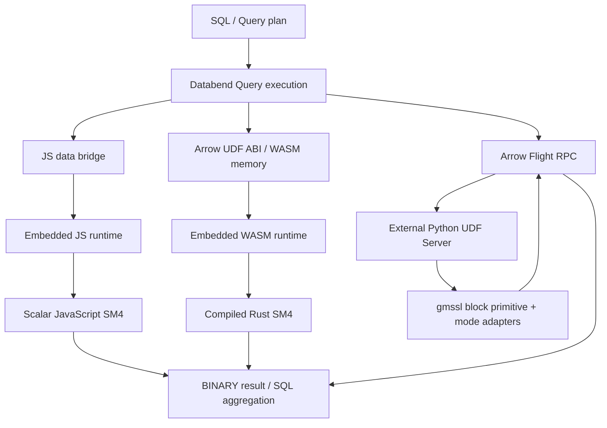

# 三种 UDF 的架构与选择

本项目比较的是三条 UDF 执行路径，不是 Databend 全部 UDF 机制的清单，也不是不同编程语言的通用跑分。
三端通过相同模式、输入数据及参数策略比较，公开明文示例统一为 `Hello Databend`。

## 1. UDF 在做什么

UDF（用户定义函数）把自定义逻辑接入 SQL 表达式，例如：

```sql
SELECT sm4_encrypt_explicit_iv_wasm(data, key_text, iv_text, 'CBC') FROM source_table;
```

SQL 仍由 Databend 规划和执行；函数体的执行位置、数据跨边界方式、运行时和运维成本有所区别。
算法、输入接口、实现是否优化、块大小和并发都会影响性能，不是只看函数名后缀。

## 2. 执行架构



这是架构示意，不是抓包、实际线程图或真实客户端截图。箭头不表示零拷贝或忽略初始化成本。

### JavaScript

源码在 CREATE FUNCTION 中内联，由 Query 的 JS 运行时处理，不需单独部署计算服务。
项目已测版本使用 QuickJS，不能把本地 Node.js/V8 的 JIT 性能当作 Query 的实际性能。
宿主需要完成数据桥接、函数调用和结果转换；当前实现还存在逐行动态数组/整数运算成本。

### WASM

Rust 源码先编译为 `.wasm`，工件通过 stage 提供给 Query。运行时加载模块并通过 Arrow UDF ABI 调用导出。
不是宿主直接运行一个 Rust 可执行文件，也不是把任意 `.wasm` 上传就能自动识别函数。
模块使用独立线性内存，输入/输出 ABI、内存和运行时转换都有成本；沙箱还需宿主的资源/能力限制。
当前测量包含每次 SQL 的初始化/编译开销，不是提前创建一次模块后单独测内核循环。

### Python Server

Query 通过 Arrow Flight RPC 调用外部 Python 进程。服务可独立部署和治理，但需要处理网络、SDK/Arrow schema、
超时和可用性；不在 Query 内嵌 JS/WASM 沙箱中运行。Python 环境的 OS/容器权限由服务部署负责。
本项目使用纯 Python gmssl 原语，不能据此判定所有 Python Server 或原生密码库的性能。

## 3. 对比维度

| 项目 | JS | WASM | Python Server |
|---|---|---|---|
| Query 外的常驻计算服务 | 不需要 | 不需要 | 需要 |
| 发布内容 | 内联 JS SQL | WASM 工件 + SQL | 服务代码/依赖 + 注册 SQL |
| 本项目的计算实现 | JS 标量算法 | Rust 编译后标量算法 | gmssl 原始分组原语 |
| Query 与外部服务 RPC | 无 | 无 | 有 |
| 主要额外边界 | JS 运行时/数据桥接 | 初始化、ABI/线性内存转换 | Arrow SDK、RPC、服务运行时 |
| 依赖管理重点 | 避免 Node 专属依赖 | 编译目标、ABI、版本化工件 | Python/Arrow/库版本、网络和进程 |
| 隔离范围 | 由宿主 JS 运行时控制 | 由宿主 WASM/WASI 能力控制 | 服务自身的 OS/容器与网络策略 |
| 运维重点 | SQL 版本和 Query 资源 | 工件/导出版本和 Query 资源 | 进程、资源、健康检查、网络/安全 |

“无外部 RPC”不等于零开销；“外部服务”不等于一定更慢。要按实际负载测端到端成本。

## 4. 如何解释性能数据

```text
SQL 端到端耗时
≈ 扫描/调度 + 数据转换/ABI + 运行时初始化 + 函数计算
  + 外部 SDK/RPC（如果有） + 结果 hash/聚合
```

这只是成本分解示意，不是通过减法得到的精确剖析。若要确定每一项占比，需要额外的 profile/微基准。

- 小规模：固定成本占比高，本项目一些场景 JS 更快。
- 大行数或长字段：计算占比上升，当前 WASM 实现的优势更明显。
- Python：SDK/RPC 和纯 Python 运算共同影响结果，不能把全部差距归因于网络。
- 预热一次不保证所有后续 SQL 都免去运行时初始化；报告仍包含真实每次 SQL 成本。
- 当前报告是单查询、单线程设置，不是并发 QPS、峰值内存或所有 CPU 核心利用率的测试。

具体数值只引用 [TEST_REPORT.md](TEST_REPORT.md) 已完成部分，测试方法见 [BENCHMARKS.md](BENCHMARKS.md)。

## 5. 推荐场景

| 需求 | 优先评估 | 原因与边界 |
|---|---|---|
| 已有内置函数满足所需语义 | 原生内置函数 | 优先复用；本项目 MD5 对照中原生在全部已测规模更快，不代表任何函数的固定倍率 |
| 快速实现轻量逻辑、少量行、少依赖 | JS | 部署简单；不能将当前 SM4 的小批量结果推广为所有 JS 逻辑 |
| ELT 的批量、CPU 密集转换，或长字段加解密；不依赖外部服务 | WASM | 将自定义计算留在 Query 中，无需额外 UDF Server；确认 ABI/资源边界并复测整条作业 |
| Data Pipeline 中依赖 Python 生态、已有业务组件或外部依赖，并需要独立发布/服务治理 | Python Remote UDF | 集成灵活，适合可接受 RPC 和服务调度成本的处理链路；需要测量端到端吞吐和失败重试成本 |
| 新设计的安全加密协议 | 审计过的安全方案 | 本项目不提供认证加密，不因 UDF 性能好就适合直接设计新协议 |

**Python Remote UDF 的主要价值是生态和工程集成，不是默认获得最低延迟。** 对低延迟查询、逐行 CPU 密集计算或吞吐要求严格的关键路径，不建议优先采用本项目这种纯 Python 标量实现，应优先评估内嵌执行、原生库、向量化或批处理方案。

Data Pipeline 本身也可能有严格的吞吐/时效要求，不能简单说“Pipeline 不需要性能”。Remote UDF 既不是完整的 Pipeline 编排系统，也不天然提供重试幂等、背压或 exactly-once；如果函数调用外部系统或产生副作用，还需按实际执行/重试语义设计限流、超时和幂等。
本次数字来自纯 Python gmssl、固定 SDK 和单查询场景，不能推广为所有 Python Remote UDF 的性能上限。

三条路线不是互斥的：可让不同业务逻辑选择不同后端，但密文互通必须保证相同实际 key/IV、模式与 padding。

### ELT 的 T 不只属于 Python Remote UDF

**WASM UDF 同样适合 ELT 的转换环节，尤其是批量、计算密集且不依赖外部服务的自定义逻辑；Python Remote UDF 更侧重生态与依赖的扩展。**


这是逻辑示意，不规定优化器的实际算子顺序。UDF 可以出现在 SQL 转换作业中，不是只服务于交互查询。
先用内置能力；缺少的计算密集逻辑可用 WASM，轻量转换可用 JS，需要 Python 库/模型/外部依赖时评估 Remote UDF。
WASM 无需为该函数额外访问独立 Server，但仍有 ABI/转换/运行时开销，并消耗 Query 的 CPU/内存；不能据此承诺所有数据处理都没有网络或 IO。

函数级测试只说明当前计算负载的表现。真实 ELT 上线还需验证源表读取、JOIN/聚合、自定义转换、目标表写入与提交的总成本，
以及并发、内存限制、超时、失败恢复、重试幂等和数据校验。不要把“函数较快”写成“整条 Pipeline 已验证高性能”。

## 6. 与原生内置函数的边界

另有 [MD5 原生/WASM 对照](../benchmarks/native-vs-wasm/REPORT.md)：16/128/1,024 B、单行到 5 万行，
每组预热一次、正式五次。本轮全部规模原生更快；1,024 B × 5 万行内置 81 ms、WASM 330 ms。
这项实验说明当前 WASM 不是“比所有原生函数更快”的路径；其价值是扩展计算能力，并在合适场景下
比当前 JS/纯 Python 实现更高效。它不提供原生 SM4 的实测数据，也不能把 MD5 的差距直接当成 SM4 的差距。

又补测了只含 MD5 的 [10 万至 100 万行矩阵](../benchmarks/native-vs-wasm/large/REPORT.md)，不重跑 identity。
1,024 B × 100 万行内置 1,471 ms、WASM 3,730 ms，相对耗时差收敛到 2.54×，原生仍更快。
同轮 10 万至 100 万行的增量成本也在报告中列出，只用于规模趋势，不能当作已扣净固定开销的内核时间。

## 7. 下一步

- [部署总览](DEPLOYMENT.md)：权限、目标一致性、备份、接口选择。
- [JS 部署](DEPLOY_JS.md)、[WASM 部署](DEPLOY_WASM.md)、[Python 部署](DEPLOY_PYTHON.md)。
