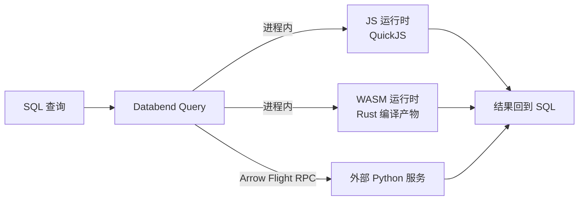
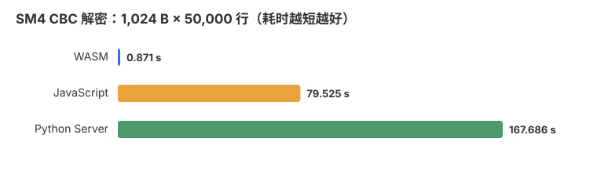
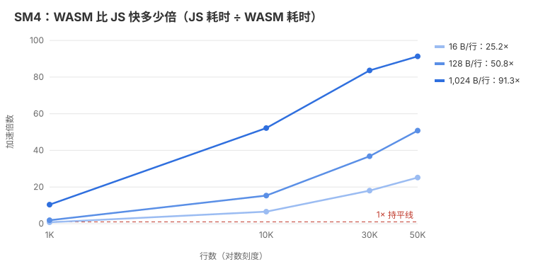
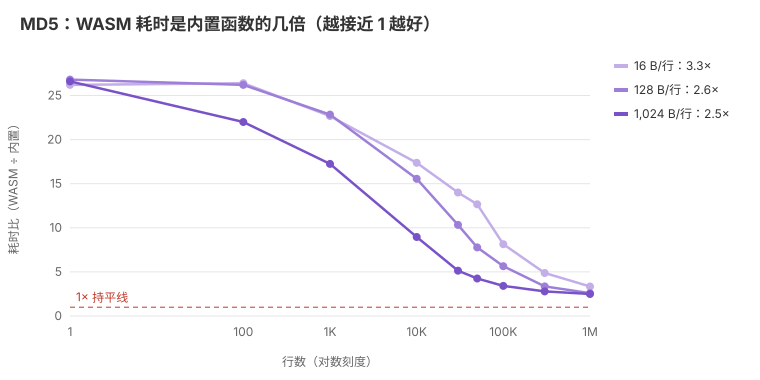
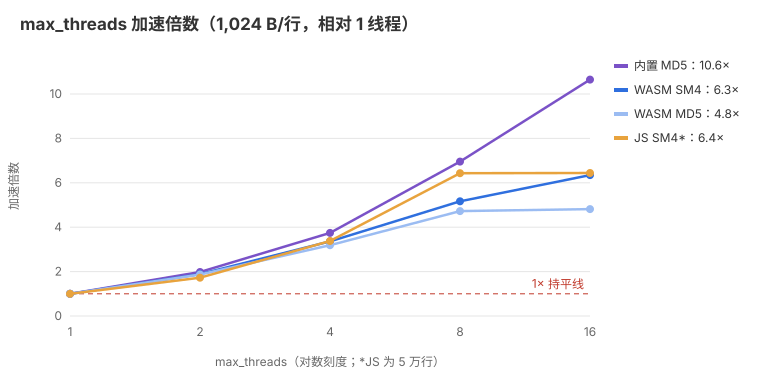
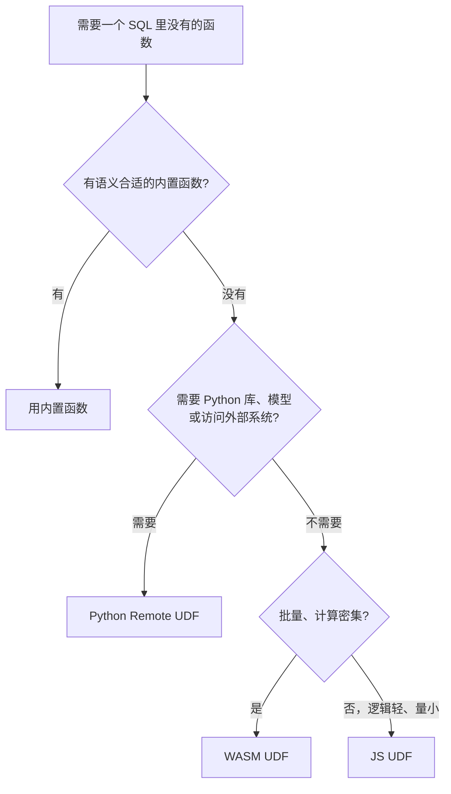

# 在 Databend 里跑 SM4：JS、WASM、Python 三种 UDF 怎么选

Databend 内置函数里没有 SM4。要在 SQL 里做国密加解密，就得自己写 UDF。Databend 提供了几种写法，本项目用 JavaScript、Rust/WASM 和 Python Server 各实现了一遍同样的 SM4，并在同一台机器上跑了对比。

先说结论：

- **批量加解密选 WASM。** 1 万行起，WASM 在所有测试规模都最快；1,024 B × 5 万行时比 JS 快约 130 倍。
- **几百上千行的小查询，JS 就够用。** WASM 每次查询有一百多毫秒的固定启动成本，量小时 JS 反而更快。
- **Python Server 胜在生态，不在速度。** 需要调用 Python 库、模型或外部系统时再用它。
- **有内置函数就用内置函数。** 拿 MD5 对比，内置函数在所有规模都比 WASM 快。

## 1. UDF 是怎么接进 SQL 的

UDF 用起来和普通函数一样：

```sql
SELECT sm4_encrypt_explicit_iv_wasm(data, key_text, iv_text, 'CBC') FROM source_table;
```

查询的解析、规划、扫描和聚合仍由 Databend 完成，只有函数体换成了你写的代码。三种 UDF 的区别在于这段代码**在哪里运行**、**数据怎么送过去**：



JS 和 WASM 跑在 Query 进程里面，Python 跑在 Query 外面的独立服务里。这一点决定了它们的性能特点和运维方式。

## 2. 三种 UDF 各是什么样

### JavaScript：写完就能用

JS 代码直接写在 `CREATE FUNCTION` 语句里，Query 内置的 QuickJS 引擎负责执行，不用上传文件，也不用起服务。改一行代码、重新建一次函数就生效，最适合轻量逻辑和快速迭代。

要注意的是，QuickJS 是解释执行的，没有 Node.js/V8 那样的 JIT。在本地 Node 里跑得很快的代码，放进 Databend 会慢不少。SM4 这类逐字节的位运算对它来说负担较重，所以数据量一大就落后了。

### WASM：编译一次，跑得最快

Rust 代码先编译成 `.wasm` 文件，上传到 stage，再用 `CREATE FUNCTION` 注册。Query 加载模块后，按 Arrow UDF 接口把一批数据交给它处理。

编译后的代码执行效率接近原生，这是 WASM 批量快的原因。代价是每次查询都要创建运行时、编译模块，大约一百多毫秒；数据还要在 Query 和 WASM 的独立内存之间来回拷贝。所以 WASM 适合“一次处理很多数据”，不适合“一次只处理几行”。

### Python Server：生态最全，链路最长

Python 代码跑在单独部署的服务里，Query 通过 Arrow Flight RPC 把数据发过去、再把结果取回来。好处是能直接用 Python 生态，服务可以独立发布、扩容和监控。

代价是多了一层网络调用，还要自己管进程、超时和可用性。本项目用的 gmssl 是纯 Python 实现，计算本身也偏慢。如果换成调用 C 实现的密码库，或者做向量化批处理，性能会有很大差别，需要重新测量。

### 一张表看区别

| | JavaScript | WASM | Python Server |
|---|---|---|---|
| 代码在哪跑 | Query 内 | Query 内 | Query 外的独立服务 |
| 要部署什么 | 一条 SQL | `.wasm` 文件 + SQL | 服务进程 + 注册 SQL |
| 网络调用 | 无 | 无 | 有（Flight RPC） |
| 主要额外成本 | 解释执行 | 每次查询的启动编译、内存拷贝 | RPC、序列化、Python 运算 |
| 运维重点 | SQL 版本 | 文件版本、编译目标 | 进程、资源、健康检查、网络安全 |

## 3. 实测：谁更快

测试做的是 CBC 解密，明文 16 B、128 B、1,024 B 三种长度，每种 1,000 到 50,000 行，单线程执行，每组取三次的中位数。

### 数据量一大，WASM 遥遥领先



同样解密 5 万行 1 KB 的数据，WASM 不到 1 秒，JS 要 80 秒，Python 要近 3 分钟。在所有规模下，Python 大约都比 JS 慢一倍。

### 量小时 JS 更快，量大时差距越拉越大



线越高，WASM 领先越多；低于红色虚线表示 JS 更快。

- 16 B × 1,000 行时，JS 用 108 ms，WASM 用 147 ms，JS 胜出。这个量级下 WASM 的时间主要花在启动上，真正的计算只占一小部分。
- 行数越多、每行越长，计算占比越高，WASM 的优势就越明显。
- WASM 的耗时增长很慢：16 B 从 1,000 行到 50,000 行只从 147 ms 涨到 178 ms，JS 却从 108 ms 涨到 4.9 s。

## 4. 和内置函数比呢

WASM 比 JS、Python 快，但和 Databend 的原生内置函数比又如何？SM4 没有内置版本，所以改用 MD5：同一个算法库、同样的输入输出，分别跑内置 `md5()` 和 WASM 版本。



线越接近红色虚线，两者差距越小。

- 只查 1 行时，内置函数 5 ms，WASM 约 130 ms，差距主要就是那一百多毫秒的启动成本。
- 到了 100 万行，1,024 B 的数据内置函数 1.46 s，WASM 3.68 s，差距缩小到 2.5 倍左右，但内置函数始终更快。
- 剩下的差距可以用“只传数据、不做计算”的 identity 函数拆开看：每行 1 KB 时，WASM 每多处理一行约 3.5 µs，其中约 1.2 µs 花在数据进出 WASM 内存上，约 2.1 µs 是 MD5 计算本身；内置函数每行约 1.5 µs。

所以顺序很清楚：**先找内置函数，没有合适的再写 UDF。** WASM 的价值是补上内置函数做不到的计算，而不是替代它们。

### 多给几个线程呢

上面的数字都是 `max_threads=1`。把同一条查询放到多数据块的表上，再把线程数从 1 调到 16：



- 数据量大时，加线程很管用：1,024 B × 100 万行，WASM SM4 从 9.3 s 降到 1.5 s，WASM MD5 从 3.8 s 降到 0.8 s。
- 数据量小时帮助有限：5 万行的表只有 7 个数据块，而且一百多毫秒的启动成本每次查询都要付一次，WASM 最多只快约 2 倍。
- 内置函数扩展得最好，所以线程越多，它和 WASM 的差距反而越大：1,024 B × 100 万行时，耗时比从单线程的 2.4 倍变成 16 线程的 5.4 倍。
- JS 也能并行，8 线程时快约 6.4 倍，但仍比同条件的 WASM 慢 40 多倍。

完整数据见 [max_threads 扩展报告](../reports/max-threads/REPORT.md)。

## 5. 怎么选



| 场景 | 推荐 | 理由 |
|---|---|---|
| 内置函数已能满足 | 内置函数 | 没有额外边界，所有规模都最快 |
| 轻量逻辑、几百上千行 | JS | 一条 SQL 就能部署，小批量时固定成本最低 |
| 批量加解密、编码转换、解析等计算密集逻辑 | WASM | 计算留在 Query 内，不用维护额外服务 |
| 依赖 Python 生态、已有业务组件或外部系统 | Python Remote UDF | 集成灵活，可独立发布和治理 |
| 设计新的加密方案 | 经过审计的认证加密方案 | 本项目的 SM4 模式不提供完整性校验 |

三种方式可以并存。不同业务逻辑可以选不同后端，只要 key、IV、模式和填充方式一致，三端产生的密文可以互相解密。

Remote UDF 本身不提供幂等、背压或 exactly-once。如果函数会写外部系统或产生其他副作用，要考虑查询重试导致的重复调用，自行设计超时、限流和幂等。

## 6. 放到 ELT 里用

在 ELT 流程中，UDF 负责的是 T（转换）这一步：


能用内置 SQL 做的先用内置 SQL，缺的计算密集逻辑交给 WASM，轻量转换用 JS，需要 Python 依赖时再用 Remote UDF。WASM 不需要额外服务，但会占用 Query 节点的 CPU 和内存，并发高时要留出余量。

上线前，建议在目标环境把整条作业跑一遍：读取、转换、写入的总耗时，峰值内存，并发表现，以及失败重跑后数据是否正确。

## 测试环境与延伸阅读

以上数据来自一台 AMD Ryzen 9 5950X 单机，Databend Query v1.2.947-nightly，关闭结果缓存。除“多给几个线程呢”一节外，都设置 `max_threads=1` 并使用 Memory 表。计时是完整的服务端 SQL 耗时，包含扫描、运行时初始化、数据转换和 RPC。并发和跨机网络场景没有测，你的环境中的数字会不同。

- 完整数据：[SM4 三端报告](../reports/sm4-backends/REPORT.md) · [MD5 1–5 万行](../reports/md5-native-vs-wasm/rows-1-50k/REPORT.md) · [MD5 10–100 万行](../reports/md5-native-vs-wasm/rows-100k-1m/REPORT.md) · [max_threads 扩展](../reports/max-threads/REPORT.md)
- 测试方法：[BENCHMARKS.md](BENCHMARKS.md)
- 部署：[部署总览](DEPLOYMENT.md) · [JS](DEPLOY_JS.md) · [WASM](DEPLOY_WASM.md) · [Python Server](DEPLOY_PYTHON.md)

文中图表由 `scripts/render_charts.py` 根据报告 CSV 生成，重新测量后运行它即可更新。
